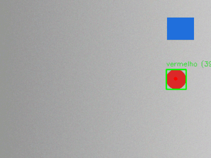
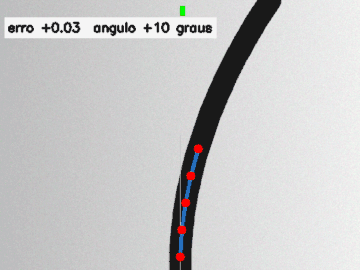

# Visão Computacional para Robótica


Dois módulos de visão computacional pensados para robôs, escritos em Python com OpenCV e NumPy:

| Rastreamento de objeto por cor | Leitura de linha para seguidor |
|---|---|
|  |  |

> Os GIFs são gerados pelo próprio código (`python -m visao demo`) a partir de imagens sintéticas.

## 1. Rastreamento por cor (`visao/cores.py`)

Encontra o maior objeto de uma cor e acompanha a trajetória quadro a quadro.

1. Desfoque gaussiano para reduzir o ruído do sensor
2. Conversão para **HSV**, em que a cor (H) fica separada do brilho (V), o que deixa a detecção mais estável com luz variando
3. `inRange` com as faixas da cor. O **vermelho** usa duas faixas, porque fica nas duas pontas do círculo de matiz (0–10 e 170–179)
4. Abertura e fechamento morfológicos para tirar pontinhos e tapar buracos
5. Maior contorno → **centroide pelos momentos da imagem**, caixa e raio
6. Rastro com as últimas N posições

Cores prontas: vermelho, laranja, amarelo, verde e azul.

## 2. Leitura de linha (`visao/linha.py`)

É a "câmera" de um robô seguidor de linha. Ela devolve o **erro** que o controle PID usa para corrigir a direção.

1. Escala de cinza e **limiar de Otsu**, que se adapta à iluminação
2. Checagem de contraste: o Otsu sempre divide a imagem em duas, mesmo sem linha nenhuma. Só aceitamos a divisão se a "linha" for bem mais escura que o fundo
3. A parte de baixo da imagem é dividida em **faixas horizontais**, e o centro da linha em cada faixa vira um ponto. Faixas com tinta demais (sombra, borda da pista) são descartadas
4. **Erro** de -1 (linha à esquerda) a +1 (direita), com peso maior para a faixa mais perto do robô
5. **Ângulo** entre o primeiro e o último ponto, que antecipa a curva

```python
from visao import linha

leitura = linha.ler_linha(quadro)
if leitura.encontrou:
    correcao = pid.calcular(leitura.erro)   # ver o projeto do firmware do seguidor de linha
else:
    procurar_linha()
```

O firmware que usa esse erro num controle PID está em [seguidor-linha-pid](https://github.com/Kauan-V-Marques/seguidor-linha-pid).

## Como usar

```bash
python -m venv .venv
source .venv/bin/activate          # Windows: .venv\Scripts\activate
pip install -e ".[dev]"

python -m visao rastrear --cor vermelho --camera 0     # webcam
python -m visao rastrear --cor azul --video entrada.mp4 --saida resultado.mp4
python -m visao linha --camera 0 --mostrar-erro
python -m visao demo                                   # regera os GIFs
```

Na janela, aperte `q` para sair.

## Testes

```bash
pytest
```

Os 23 testes usam **imagens sintéticas com resposta conhecida**: a bola é desenhada numa posição exata e a linha num deslocamento exato. Assim dá para conferir a precisão:

- centro da bola com erro de até 2 px, para as 5 cores, mesmo com outro objeto colorido na cena
- vermelho na segunda faixa do matiz, objeto pequeno tratado como ruído e cor inexistente com erro claro
- rastreamento ao longo de uma trajetória em "8"
- erro da linha proporcional ao deslocamento e com o sinal certo, ângulo indicando o lado da curva
- linha perdida, sombra grande que **não** pode ser confundida com linha, trecho apagado e ruído diferente a cada quadro

O GitHub Actions roda lint (ruff), os testes em Python 3.11, 3.12 e 3.13 e a geração das demonstrações.

---

<details>
<summary>English</summary>

### Computer Vision for Robotics

Two OpenCV modules for robots:

- **Color tracking:** HSV segmentation (red uses two hue ranges), morphological cleanup, centroid from image moments, motion trail
- **Line reading for a line-follower robot:** Otsu thresholding with a contrast check (Otsu always splits an image, even with no line), horizontal bands, weighted error from -1 to +1 and heading angle, ready to feed a PID controller

CLI for webcam or video files, reproducible demo GIFs, and 23 tests on synthetic images with known ground truth, running on Python 3.11–3.13 in GitHub Actions.

</details>
